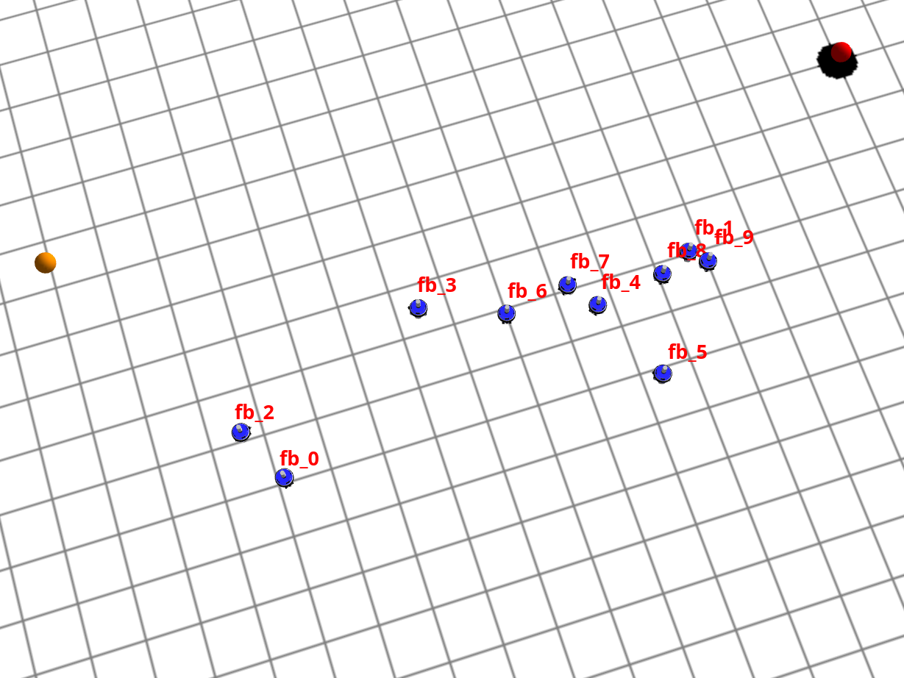
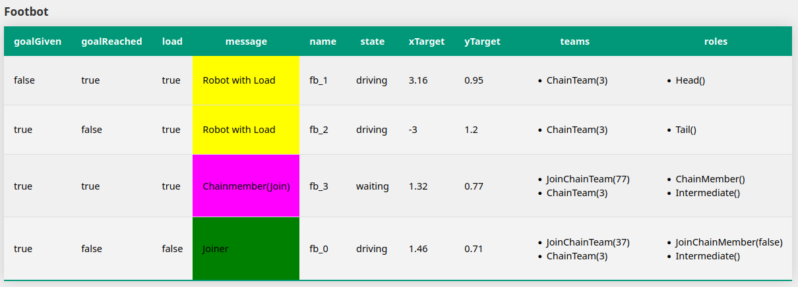
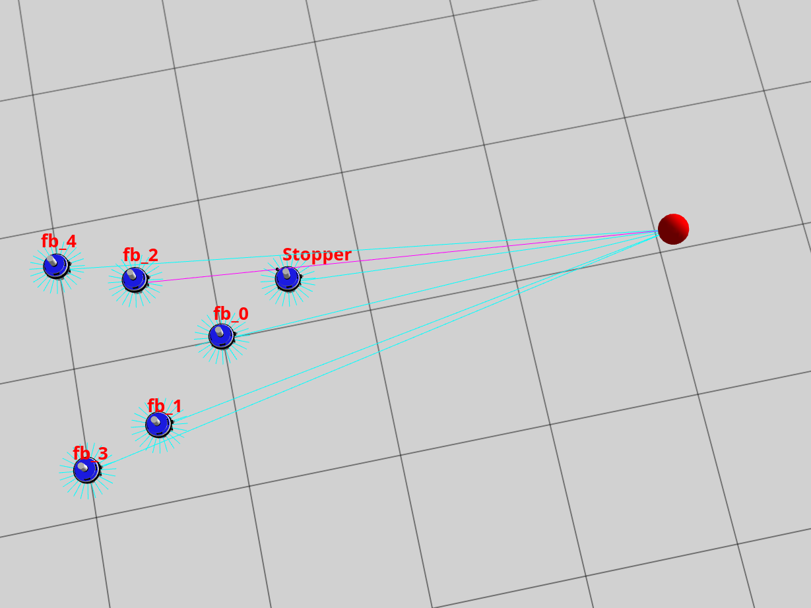

# Using Context Role-oriented Programming for Swarms to Alleviate the Micro-Macro Problem

| Use-Case | VRB-EASE Lab| Icon |
|------|------------|------------------|
|**Transport Chain Swarm:**| [](https://binder.intel4coro.de/v2/gh/XPhantomad/VRB-CROM-TransportChainSwarm2/main?urlpath=lab/tree/notebooks/instructions.ipynb) ||
|**V-Shape Flocking Swarm:**| [](https://binder.intel4coro.de/v2/gh/XPhantomad/VRB-CROM-TransportChainSwarm2/main?urlpath=lab/tree/notebooks/instructions.ipynb)| | 

#

This repository contains the code of our implmentation of a Foraging Chain Swarm in ARGoS3 using Context-Role-Oriented Programming.

The overall system is comprised of multiple subsystems, which have to be installed and started independently. 

We use ROS2 Jazzy, which is only easy to install if you follow the version restrictions for the underlying Linux. 
In terms of performance, we encourage to install <b>Ubuntu 24.04 (not 24.10 or the latest version)</b> bare-bones, i.e., not in a virtual machine.
Using a virtual machine is possible, but degrades performance considerably.

A detailed description of how to install ROS2 on your system can be found [here](https://docs.ros.org/en/jazzy/Installation.html).

Besides ROS2, we use ARGoS3 as simulator. Instructions on how to install the simulator can be found below.

Our prototype is comprised of five main parts in the following subdirectories:

- swarmElementLoop: contains the implementation of the <b>Swarm Element Loop</b> using [Contexts.jl](https://github.com/cgutsche/Contexts.jl)
- rosWorkspace: contains the implementation of the [ROS2-ARGoS3 bridge](https://github.com/einstein07/collective-decision-making-argos-ros2) including the UI extensions for our example (e.g., showing the names of the robots in ARGoS3)
- singleRobotLoop: contains the <b>Single Robot Loop</b> implemented in Python using PyEcore for the runtime model
- messagesComponent: contains the <b>Messages Component</b> responsible to process the monitored sensor values from the robots and to pass them to the swarm element loop
- webapp: contains the dashboard to observe the overall system

The singleRobotLoop, messages and webapp components all use Python and require an own Python Environment to install the required dependencies.
The swarmElementLoop component requires Julia to be installed.

## Demo

Short Teaser: [Watch the video](https://youtu.be/W2dG7L7vDxQ)

Explanation: [Watch the video](https://youtu.be/M2knKsVhV9w)

## Quickstart VRB-EASE Lab

- open the Virtual Research Building EASE Lab of the [Context Role-oriented Transport Chain Swarm](https://vrb.ease-crc.org/explore-labs/cromms-self-organized-transport-chain-swarm/) and explore the content
- or launch the Lab directly via the binder icon above

## Quickstart with Docker

- install Docker

### Transport Chain Swarm

- ```git clone git@github.com:XPhantomad/Context-Role-Oriented-Transport-Chain-Swarm.git ```
- move to "rosWorkspace" and run ``` sudo docker build -t argos3-ros2-tchain . ```
- wait until image is ready
- run the run.sh in the main folder with sudo
- open http://localhost:5000/ in your browser to see the swarm dashboard

### Flocking Swarm

- (it can be necessary to delete the first created image, because otherwise only a new tag for this image will be added)
- checkout the "flocking" branch of the repository
- move to "rosWorkspace" and run ``` sudo docker build -t argos3-ros2-flocking . ```
- run the run.sh in the main folder with sudo
- open http://localhost:5000/ in your browser to see the swarm dashboard

### Publish Image

- Change Tag of the Image: ``` sudo docker tag [ID] xphantomad/crom-v-shape-flocking:latest ```
- Push Image: ``` sudo docker image push xphantomad/crom-v-shape-flocking:latest ```


## System Requirements

- Ubuntu 26.04 LTS
- ROS2 Lyrical Desktop (sudo apt install ros-lyrical-desktop)
- python 3.14.4
- python venv (```sudo apt install python3.14-venv```)
- julia 1.13.3 (```curl -fsSL https://install.julialang.org | sh```)
- colcon (```sudo apt install colcon```)
- rqt
- tmux 3.4 (```sudo apt-get install tmux```)

### Install Argos3 Simulator

- Prerequisites:
  - ```sudo apt-get install cmake libfreeimage-dev libfreeimageplus-dev qtbase5-dev qtbase5-dev-tools qt5-qmake qtchooser freeglut3-dev libxi-dev libxmu-dev liblua5.3-dev lua5.3 doxygen graphviz libgraphviz-dev asciidoc ```
  - Freeglut 3: Problem with libglut.so.3.12
    1. Install the freeglut3-dev package with:

       ```sudo apt install freeglut3-dev```
    2. Change to the /usr/lib/x86_64-linux-gnu directory by enter: 

       ```cd /usr/lib/x86_64-linux-gnu```
    3. Now create a new symlink with name libglut.so.3 which points to libglut.so.3.12.0:

        ```ln -s libglut.so.3.12.0 libglut.so.3```
- Download argos3_simulator-3.0.0-x86_64-beta59.deb (in Folder *Dependencies*)
- ```sudo apt install ./argos3_simulator-3.0.0-x86_64-beta59.deb```

Verify Installation
- ```git clone https://github.com/ilpincy/argos3-examples.git``` to Documents
- compile and test with instructions from https://github.com/ilpincy/argos3-examples
- ```argos3 -c ./experiments/diffusion_1.argos``` shuold throw no error

### Install GSL for Argos3-ROS2-Bridge

- https://coral.ise.lehigh.edu/jild13/2016/07/11/hello/
    - ```sudo apt-get install libgsl-dev```
    - Download gsl-latest.tar.gz (in Folder *Dependencies*)
    - ```tar -zxvf gsl-latest.tar.gz```
    - ```cd gsl-2.8```
    - ```mkdir /home/[yourname]/gsl```
    - ```./configure --prefix=/home/[yourname]/gsl```
    - ```make``` (takes a while)
    - ```make check```
    - ```make install```
    - ```'export LD_LIBRARY_PATH=/home/[yourname]/gsl/lib:$LD_LIBRARY_PATH' >> ~/.bashrc ```

## Install Application
- ```git clone git@github.com:XPhantomad/Context-Role-Oriented-Transport-Chain-Swarm.git ```
- ```cd Context-Role-Oriented-Transport-Chain-Swarm```
- ```chmod +x ./run.sh```
- ```chmod +x ./Flocking_initializeStopper.sh```
- ```chmod +x ./Flocking_removeStopper.sh```

### Prepare Simulation
- (Advanced: If it is planned to use the ARGoS simulator for multiple repos, it is recommended to copy the rosWorkspace folder in the home directory) 
- open a terminal in the folder "/rosWorkspace":
    - ```source /opt/ros/jazzy/setup.bash```
    - ```./build.sh``` (it colcon builds the argos3-ros2-bridge firstly without plugins and secondly with plugins; it uses two CMake files for that)
    - ```source install/setup.bash```
    - ```argos3 -c transportChainSwarm.argos```
    - --> simulation should be ready



### Setup Swarm-Element-Loop

- in a new terminal enter:
    - ```julia```
    - ```import Pkg```
    - ```Pkg.add(["Sockets", "JSON", "Parameters"])```

### Setup Startup-Script

- in "startup" folder setup a venv and install required packages:
    - open terminal and create python venv: ```python3 -m venv ./```
    - ```source bin/activate```
    - install required pip packages (```pip install -r requirements.txt```)


### Single-Robot-Loop (only requried for single Robot startup)

- in singleRobotLoop and messagesComponent folder setup venv:
    - open terminal and create python venv: ```python3 -m venv ./```
    - ```source bin/activate```
    - install required pip packages (```pip install -r requirements.txt```)
    - run: ```python3 main.py```
    - quit application

### Webapp (requried only for single Robot startup)
- in webapp folder setup venv:
    - open terminal and create python venv: ```python3 -m venv ./```
    - ```source bin/activate```
    - install required pip packages (```pip install -r requirements.txt```)
    - run: ```python3 swarmDisplay.py```
    - quit application

## Run Transport Chain Swarm Application
### Part1: Run the simulation 
- in "rosWorkspace" run: 
    - ```source install/setup.bash```
    - ```argos3 -c transportChainSwarm.argos```
    - start simulation by clicking the **play** button

### Part2: Run Robot Controllers via Startup Script
- in "Context-Role-Oriented-Transport-Chain-Swarm" folder run:
    - ```source ./rosWorkspace/install/setup.bash```
    - ```source ./startup/bin/activate```
    - ```python3 ./startup/automatedStartup.py``` (adjust number of iterations depending on the number of robots)
- the "automatedStartup.py" runs the Webapp and the Robots with its 3 components successive
- open the swarm dashboard for visualization of the teams and roles: http://localhost:5000/



### Run Robots one by one (alternative to startup script --> seperate output for each Robot)
1. [run simulation](#run-simulation)
2. in Web App run (absolutely necessary before starting the robots):
    - ```source bin/activate```
    - ```python3 swarmDisplay.py```
    - (connect to Web App via http://localhost:5000/)

3. ```./startup.sh [footbot-name]``` (e.g. "fb_0")
4. start the command above for all robots in the simulation robots in seperate terminals 
5. wait until robot is driving before starting the next one!! (otherwise tmux will be confused) 
- left pane in tmux shows output of the Swarm Element Loop
- right top pane shows output of the Single Robot Loop
- right bottom pane shows output of the Messages Component

6. stop application:
    - Strg+b d  (to detach from tmux)
    - run ```tmux kill-server``` in cli

## Run the V-Shape Flocking Application

### Run Flocking Simulation

- in "rosWorkspace" run:
    - ```source install/setup.bash```
    - ```argos3 -c flockingSwarm.argos```
    - start simulation by clicking the **play** button
 


### Run Flocking Robots via Startup Script

- in "Context-Role-Oriented-Transport-Chain-Swarm" folder run:
    - ```source ./rosWorkspace/install/setup.bash```
    - ```source ./startup/bin/activate```
    - ```python3 ./startup/automatedStartupFlocking.py```
- the "automatedStartupFlocking.py" runs the Web App and the Robots with its 3 components successive
- it also controls the *Stopper* robot which stops the leader until all robots are started
- open the swarm dashboard for visualization of the teams and roles: http://localhost:5000/


## Run Tests

- in  "Context-Role-Oriented-Transport-Chain-Swarm" folder run:
    - ```source ./rosWorkspace/install/setup.bash```
    - ```source ./startup/bin/activate```
- run tests with (e.g.):
    - ```python3 RobotWithLoadDetected.py```
- Test: PreyDetected.py runs the test only once, because this action cannot be reseted without restarting the application
- Execution Times are stored in associated files (e.g. time_RobotWithLoadDetected.txt)
- After running all tests the ExecutionTime can be plotted with ./ExecutionTimeMeasurements/timePlotToolFSET_4Cases.py
- For that execute in main folder:
    - ```source ./executionTimeMeasurements/bin/activate```
    - ```python3 ./executionTimeMeasurements/timePlotToolFSET_4Cases.py```

### Create SEL-SRL-MSG Execution Time Plot
- uncomment lines 37 and 77-79 in messages/main.py
- uncomment lines 95-98 and 135-139 in runtimemodel/main.py
- run simulation ([here](#run-simulation)) and execute automatedStartup.py as mentioned before [here](#run-robots-via-startup-script)
- execution times of the SEL will always be stored in time.txt
- execution times of SRL will be stored in timeSRL.txt
- execution times of Messages Component will be stored in timeMSG.txt
- after running the application for a while, stop
- plot times with ```python3 executionTimeMeasurement/timePlotToolSEL_SRL_MSG.py``` executed from the main folder

### Create Plot for Scalability
- run application ([run simulation](#run-simulation) & [startup](#run-robots-via-startup-script)) for different numbers of robots ([change robot number](#change-robot-number-in-simulation))
- after each run, save the times.txt with another name (e.g. timeXRobots.txt)
- after having 4 measurements, plot them with ```python3 executionTimeMeasurement/timePlotToolScalability.py``` (change names of the used timeXRobots.txt files)


## Change Robot Number in Simulation
- in your "rosWorkspace" change the following parameters
- in "rosWorkspace_/bridge_example.argos":
    - change ```position``` of the Prey light (position = x,y,z)
    - change the distributioin of robots by adjusting the ```<position>``` min and max Positions and the ```<entity>``` quantity
    ```html
    <light id="Prey"
            position="5,1,0.2"
            orientation="0,0,0"
            color="red"
            intensity="1.0"
            medium="leds" />
    ...   
    <distribute>
        <position method="uniform" min="-2.5,-2.0,0" max="6,4.0,0" />
        <orientation method="uniform" min="0,0,0" max="360,0,0" />
        <entity quantity="15" max_trials="100">
            <foot-bot id="fb_">
            <controller config="lrb" />
            </foot-bot>
        </entity>
        </distribute> 
    ``` 
    - change the position where the black circles will be spawned to the new Prey position: Change the "xpos" and "ypos" paramter in the ```<foraging>``` entry (you can adjust the "radius" and the amount of "items" that will be spawned too)
    ```html
        <loop_functions library="build/argos3_ros2_bridge/plugins/loop_functions/foraging_loop_functions/libforaging_loop_functions.so"
                  label="foraging_loop_functions">
            <foraging items="10"
                    radius="0.2"
                    xpos="5"
                    ypos="1"
                    energy_per_item="1000"
                    energy_per_walking_robot="1"
                    output="foraging.txt" />
        </loop_functions>
    ```
- in "swarmElementLoop/transportChain/MAPE.jl" adjust the Exploration area constants at the beginning of the file (set the area optimally around the prey; otherwise, the robots need unduly long to find the prey and start forming a chain)
    ```julia
    EXPLORATION_POS1 = Position(1.0, -1.0) 
    EXPLORATION_POS2 = Position(6.0, 3.0) 
    ...
    ```

## Demo

Short Teaser:

[](https://youtu.be/YxY3P1U7E8I)

Explanation 1:

[](https://youtu.be/M2knKsVhV9w)
